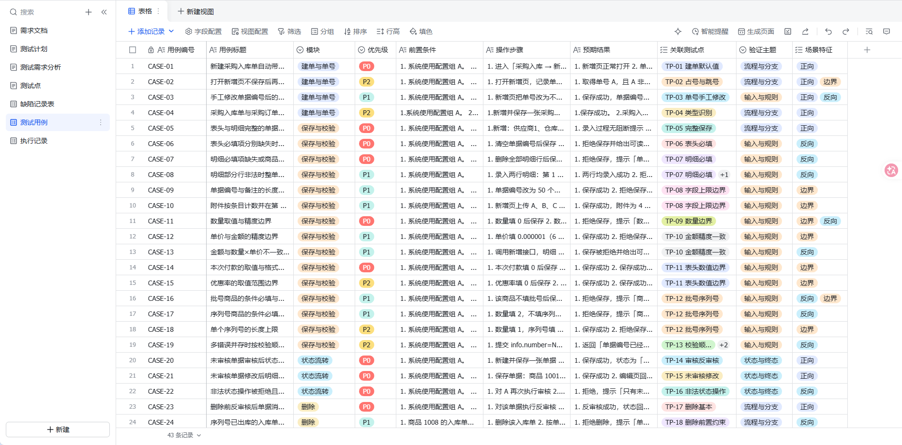
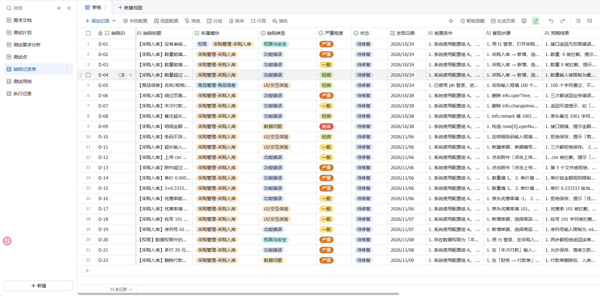
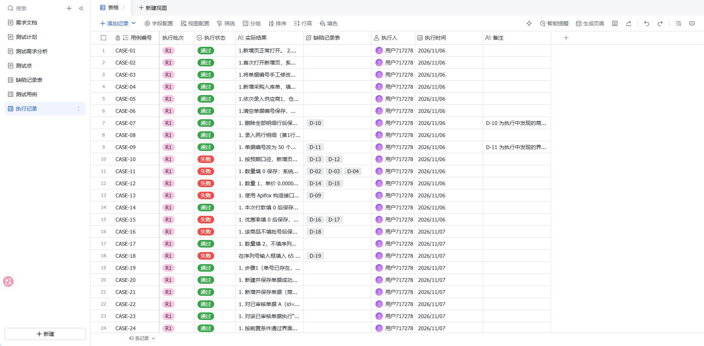

# jshERP 采购入库功能测试

面向校招测试岗的个人测试实践：对一个真实开源进销存系统（jshERP）完成一轮采购入库功能测试，完整走通需求逆向 → 用例设计 → 执行取证 → 缺陷分析，并用 pytest 补了接口层自动化。

## 30 秒摘要

- **被测系统**：jshERP（管伊佳ERP），国产开源进销存 + 财务系统，Spring Boot + Vue + MySQL + Redis
- **测试范围**：采购入库主链路——单号、保存校验、状态流转、删除、库存、权限、金额与欠款、异常提示
- **产出**：43 条手工用例、43 条执行记录（30 通过 / 13 失败）、22 条缺陷（1 致命 / 9 严重）、35 个接口层测试项
- **方法**：手工功能测试为主，SQL 直连对账 + Apifox 接口验证；飞书多维表格管理用例、执行与缺陷；pytest 补接口自动化
- **个人独立完成**：需求逆向、用例设计、执行取证、缺陷分析、接口自动化与文档整理

## 关键数字

> 手工测试为 R1 轮次（2026-11-06～11-08）；接口自动化为 2026-11-12 全量执行。

| 指标 | 数值 |
|---|---|
| 测试关注点 / 测试点 | 39（TC-01～TC-39）/ 32（TP-01～TP-32） |
| 手工用例 | 43（CASE-01～CASE-43） |
| 执行结果 | 30 通过 / 13 失败 |
| 发现缺陷 | 22（D-01～D-22），全部待修复 |
| 严重程度 | 致命 1 / 严重 9 / 一般 8 / 轻微 4 |
| 缺陷类型 | 功能错误 13 / UI 交互 5 / 权限安全 2 / 数据问题 2 |
| 接口自动化 | 35 个 test item（28 默认 + 7 写），35 passed |
| 接口调用 / 残留 | 100 次（只读 78 / 会话 1 / 写 21），`API-` 单据残留 0 |
| 上游 commit | `26f301a9` |

## 过程与结果

以下截图为飞书多维表格的实际视图，本地 Markdown / CSV 是同一定稿镜像。

### 测试用例：43 条，覆盖建单 / 保存 / 状态 / 删除 / 库存 / 权限 / 金额



### 缺陷记录：22 条，按严重程度分级，全部附复现步骤



### 执行记录：43 条，逐条记录结果与关联缺陷



## 代表性缺陷

三条都属于同一类问题：**界面做了拦截，服务端没有**。

- **D-09（致命）金额与数量×单价不一致也能落库**：绕过页面构造 `allPrice=999`、`totalPrice=-100`，接口返回成功并原样落库；后端不按数量×单价重算或校验。证据：CASE-13 查库结果。
- **D-01（严重）没有审核权限也能审核**：无审核按钮权限的账号直接调用 `POST /depotHead/batchSetStatus`，接口未做按钮权限校验，单据状态 0→1。CASE-34、CASE-38 均复现。
- **D-20（严重）越权读取单据详情**：本部门数据权限账号在列表查不到跨部门单据，但直接调 `getDetailByNumber` / `getDetailList` 能拿到完整表头与明细。

完整 22 条见 [缺陷记录表-已知缺陷.csv](docs/测试文档/缺陷记录表-已知缺陷.csv)。

## 文档地图

| 阶段 | 文档 | 内容 |
|---|---|---|
| 需求 | [需求规格说明](docs/测试文档/需求规格说明.md) | 应然需求：范围、权限、状态、业务规则、配置影响、异常文案、阈值 |
| 计划 | [测试计划](docs/测试文档/测试计划.md) | 目标、范围、策略、环境、准入准出、进度、风险 |
| 分析 | [02-测试需求分析](docs/测试文档/02-测试需求分析.md) | 39 条测试关注点（TC）、16 条待确认项（Q）、16 条实现现状（A）、7 条业务口径（B）、4 条清单外发现（X） |
| 设计 | [03-测试点](docs/测试文档/03-测试点.md) / [Xmind](docs/测试文档/jshERP系统测试点.xmind) | 32 条测试点（TP）、22 条需求项（REQ）、覆盖检查 |
| 用例 | [04-测试用例](docs/测试文档/04-测试用例.md) | 用例正本 43 条（CASE-01～CASE-43） |
| 执行 | [04-测试执行](docs/测试文档/04-测试执行.md) | R1 执行记录 43 条（30 通过 / 13 失败） |
| 缺陷 | [缺陷记录表-已知缺陷.csv](docs/测试文档/缺陷记录表-已知缺陷.csv) | 22 条缺陷（D-01～D-22），含复现步骤与修复建议 |
| 证据 | [缺陷截图](docs/测试文档/缺陷截图) | D-10～D-19 共 11 张；其余 12 条以查库 / 接口 / 源码文字证据记录 |
| 接口 | [api-tests/](api-tests/) | pytest 接口自动化：方案、接口清单、用例、执行维护、代码规范 |

测试文档目录的编号规则、版本规则与配置基线见 [docs/测试文档/README.md](docs/测试文档/README.md)。

**推荐阅读路径**：本页 → 04-测试执行 → 04-测试用例 → 缺陷 CSV → 需求规格说明。

## 接口自动化

接口层在 [`api-tests/`](api-tests/) 中独立维护，与手工测试分开记录，接口结论不混入 43 条手工用例。

- 2026-11-12 全量执行：**35 passed / 43.1s**；接口调用 100 次全部命中白名单；执行后 `API-` 前缀单据残留 0
- 覆盖只读契约、鉴权与会话、异常边界，以及 W01–W06 写流程（新增 → 审核 → 反审核 → 编辑 → 删除、新增失败后主表回滚）
- 写用例用 `API-` 唯一单号造数，`finally` 清理；写请求串行、2 秒间隔，不直接改库

```powershell
cd api-tests
.\.venv\Scripts\Activate.ps1
pytest                                      # 默认安全集，28 项
pytest -m "not config and not permission"   # 安全集 + 写套件，35 项
pytest -m write                             # 只跑写套件，需单独授权
```

文档：[01-方案与架构](api-tests/docs/01-方案与架构.md)、[02-接口清单](api-tests/docs/02-接口清单.md)、[03-框架设计与骨架](api-tests/docs/03-框架设计与骨架.md)、[04-接口测试用例](api-tests/docs/04-接口测试用例.md)、[05-执行与维护](api-tests/docs/05-执行与维护.md)、[06-代码规范](api-tests/docs/06-代码规范.md)。

## 测试资产

- 需求规格说明：[飞书云文档](https://zwy-linlin.feishu.cn/docx/GXG4diK7GoOfqlxE803cAFlXnBh)
- 测试计划：[飞书云文档](https://zwy-linlin.feishu.cn/docx/GvBRdvYnXoR5lvxGvgjcqOODn7b)
- 用例库：[04-测试用例.md](docs/测试文档/04-测试用例.md)（43 条，v1.0）
- 缺陷库：[飞书多维表格](https://zwy-linlin.feishu.cn/base/M3U3bt1Hfad2eFsWRT3cAfrrn0e?table=tbl3OefR9cRAgm51&view=vew3TPKmsz)（22 条，D-01～D-22）
- 执行记录：[04-测试执行.md](docs/测试文档/04-测试执行.md)（30 通过 / 13 失败）；执行证据为缺陷记录「附件」列的截图 + 「备注」中的 SQL / 接口结果

> 飞书多维表格是执行与缺陷的维护副本；本仓库中的 Markdown / CSV 是定稿镜像。

## 被测系统与复现

- 上游仓库：<https://github.com/jishenghua/jshERP>，本轮基于 commit `26f301a9`。
- 本地环境：Windows 11、JDK 8、Node 20、Maven、MySQL 8、Redis；后端 9999、前端 3000。
- 部署脚本、数据库脚本、被测源码不随本仓库发布；复现请按上游仓库说明部署。
- 本地演示账号：`jsh / 123456`（jshERP 默认演示账号，仅本机使用）。

## 目录结构

```text
jshERP-purchase-inbound-test/
├── README.md
├── api-tests/
│   ├── README.md
│   ├── client.py / conftest.py / config.py
│   ├── tests/                 # 冒烟、契约、鉴权、异常、写流程
│   └── docs/                  # 01-方案 ~ 06-规范
└── docs/
    ├── images/                 # README 截图
    └── 测试文档/
        ├── README.md
        ├── 需求规格说明.md
        ├── 测试计划.md
        ├── 02-测试需求分析.md
        ├── 03-测试点.md
        ├── 04-测试用例.md
        ├── 04-测试执行.md
        ├── jshERP系统测试点.xmind
        ├── 缺陷记录表-已知缺陷.csv
        └── 缺陷截图/           # 11 张缺陷截图
```

## 诚实声明

- 本文档体系由 AI 辅助整理，所有测试结果均来自实际执行与飞书记录，不预先编造。
- 需求规格说明是**根据代码和界面逆向整理**，不是原始需求文档。
- 上游仓库存在已知未修复的安全问题（#156、#158、#159、#165），本项目**不复现高危项**，仅在测试文档中说明。
- 本轮**不修改产品代码**，22 条缺陷全部待修复，只给修复建议；未做修复回归。
- 接口自动化是接口层测试，不包含 UI 自动化；未接入 CI，回归靠本地串行执行。
- 部署只覆盖 Windows 实测路径，Linux / Docker 未验证。
