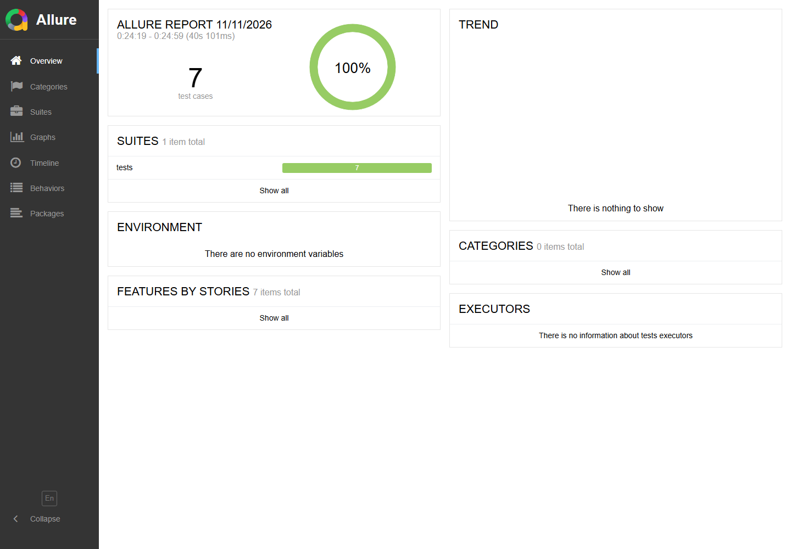

# jshERP 采购入库 接口自动化

> 状态：M3 写用例 W01–W06（W06 参数化 2 个）均已执行通过（2026-11-11）｜ 设计文档见下方[文档](#文档)索引

## 目标

用 pytest + requests 覆盖采购入库主链路的接口层判定，与手工测试互补；接口结论不混入本轮 43 条手工用例。

## 环境

- Python 3.12
- jshERP 后端：`http://localhost:9999/jshERP-boot`
- MySQL 3307、Redis 6379（后端依赖）
- 演示账号见仓库根 README「被测系统与复现」

## 快速开始

```powershell
cd api-tests
python -m venv .venv
.\.venv\Scripts\Activate.ps1
pip install -r requirements.txt
Copy-Item .env.example .env
# 编辑 .env，填入 LOGIN_NAME / PASSWORD
pytest -m smoke
```

## 报告

```powershell
New-Item -ItemType Directory -Force reports | Out-Null
pytest -m smoke --html=reports/report.html --self-contained-html
```

Allure：

```powershell
pytest --alluredir=reports/allure-results
allure generate reports/allure-results -o reports/allure-report --clean
allure open reports/allure-report
```

## 最近一次执行结果

- 默认安全套件：**28 passed**（只读 32 / 会话 1 / 写 0 次调用），0.96s
- 写套件：**7 passed**（W01–W05 各 1 个 + W06 两个参数集，21 次写调用），40.5s；执行后 `API-` 前缀单据 0 条



上图为 2026-11-11 写套件执行后的 Allure 概览，两组套件分两次执行；用例编号与判定见 [04-接口测试用例](docs/04-接口测试用例.md)。

## 目录

- `docs/`：设计文档，见下方文档索引
- `config.py`：读取 `.env`
- `client.py`：登录与 HTTP 封装；`READONLY_CALLS` / `SESSION_CALLS` / `WRITE_CALLS` 事前拦截，写接口需 `allow_write=True`
- `conftest.py`：只读 fixture（`client`、`demo_data`）与写 fixture（`write_client`、`created_bill`）
- `utils/data.py`：写用例的单号、请求体、查询与清理
- `tests/`：pytest 用例（`test_smoke.py` 冒烟、`test_contract.py` 只读契约、`test_auth.py` 鉴权与会话、`test_exception.py` 异常、`test_write_inbound.py` 写流程、`test_write_support.py` 写支撑模拟）

## 文档

- [01-方案与架构](docs/01-方案与架构.md)
- [02-接口清单](docs/02-接口清单.md)
- [03-框架设计与骨架](docs/03-框架设计与骨架.md)
- [04-接口测试用例](docs/04-接口测试用例.md)
- [05-执行与维护](docs/05-执行与维护.md)
- [06-代码规范](docs/06-代码规范.md)

## 约定

- `.env`、`.venv/`、`reports/` 不入库
- 所有请求只走 `client`；未登记接口在发送前报错，写接口只能由 `write_client` 在 `write` 用例中调用
- 默认 `pytest` 只跑安全用例；写操作用 `pytest -m write`（需单独授权、串行执行），配置用 `-m config`（需 `RUN_CONFIG_TESTS=1`），权限用 `-m permission`
- 失败时先检查后端 9999 是否启动、账号是否正确；`前置数据不足` 的跳过说明演示数据缺失，不是用例失败
