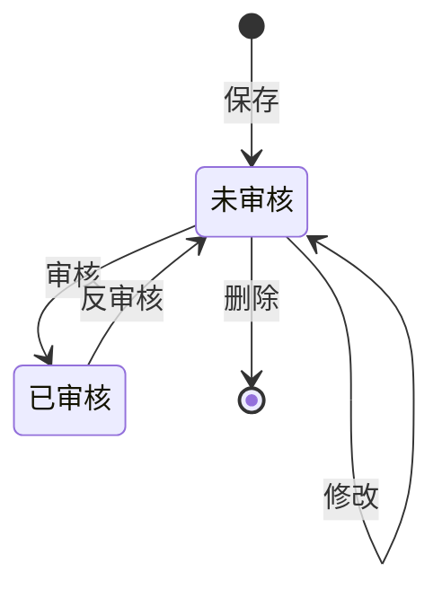

# 02 - 测试需求分析：jshERP 采购入库

> 阶段：测试需求分析（阶段一） ｜ 版本：v1.0（发布版） ｜ 日期：2026-11-02
> 输入：需求规格说明（完整原文）；测试计划（仅取范围、目标、配置基线约束，不作需求来源）
> 下游：`03-测试点.md`（测试点提取）

## 修订记录

| 版本 | 日期 | 变更 | 说明 |
|---|---|---|---|
| v0.1 | 2026-10-28 | 初稿 | 基于需求规格说明全文；待确认项尚未核对 |
| v0.2 | 2026-10-31 | 核对实现现状 | 补充 A 类 16 条现状与 B 类 7 条口径；新增 TC-39；口径当时待确认（v0.3 已确认） |
| v0.3 | 2026-10-31 | 确认业务口径 | B-01~B-07 全部确认，与当前实现一致；16 条 Q 全部关闭，文档进入定稿候选 |
| v0.4 | 2026-10-31 | 按钮权限修正 | 编号 1 改为 8 个入口的描述；TC-30 同步；Q-07 改为部分确认；A-07、X-02 更新 |
| v1.0 | 2026-11-02 | 发布版 | 内容与 v0.4 一致；代码位置引用改为模块级说明，便于在飞书中发布 |

---

## 0. 范围与前提

### 0.1 原文与覆盖范围

**原文完整性**：完整。需求规格说明共九章 + 附录，本文档描述采购入库本轮范围内的应然行为。

**覆盖章节**：二（背景与范围）、三（角色与权限）、四（单据类型与生命周期）、五（业务流程）、六（业务规则）、七（配置开关的影响）、八（异常场景与提示）、九（阈值清单）、附录（需求与实现的已知差异）。

**不在范围**（依据 §2.2 与测试计划 §三 Out）：

- 采购订单关联与分批入库（含订单状态回写）
- 财务凭证、应付账款
- 多级审批
- 序列号、批号、多单位的完整链路（仅各保留 1 条针对性验证）
- 商品档案维护
- 性能、安全渗透
- 并发场景（单用户环境无法构造）

**结论范围**：本分析相对于所提供的完整原文及上述范围声明；范围外功能不生成关注点。

### 0.2 分析前提

| 项 | 取值 | 对分析的影响 |
|---|---|---|
| 强审核开关 | 开启 | 保存不计入库存、审核计入、反审核扣除；库存类关注点的预期以此为前提 |
| 更新单价开关 | 关闭 | 保存单据不改写商品档案价格，基准稳定 |
| 其余开关 | 全部关闭 | 不介入采购入库主链路 |
| 租户配置 | 租户级 | 切换会影响该租户所有后续操作 |
| 判定标准 | 以需求规格说明为准 | 附录 8 条为已知实现差异；测试中按"需求预期 vs 实际"记录，不重复计为新缺陷 |

### 0.3 编号约定

- `TC-xx` = Test Concern（测试关注点），不代表测试用例，也不代表风险等级。
- `Q-xx` 仅在本文档内唯一；引用其他文档中的核实项时加文件名前缀（如 `07-Q-xx`），与本文件编号不混用。
- 附录中的 `D-xx` 沿用原文编号。

---

## 1. 需求理解

### 1.1 需求目标

验证采购入库单从建单到删除的完整生命周期，以及它对库存、权限、字段校验三类横切规则的实际影响。采购入库是进销存链路的起点：采购的商品通过它入库，库存随之增加，后续才能销售出库。

### 1.2 使用场景与角色

| 角色 | 场景 | 关注差异 |
|---|---|---|
| 租户业务用户 | 在采购入库页面录入单据、保存、审核、修改、删除 | 不同按钮权限决定可用动作 |
| 自定义角色用户 | 由管理员配置菜单、按钮、数据三档权限 | 权限组合会改变可见与可操作范围 |
| 仓库/财务相关角色 | 通过单据间接影响库存与往来 | 本轮不验证财务侧，只验证单据侧的前置约束 |

同一租户内不同数据权限的用户看到的单据范围不同；同一张单据在不同状态下可执行的动作也不同。

### 1.3 核心结果

1. 单据在「未审核 / 已审核」之间按规则流转，非法动作被拒绝且状态不变。
2. 保存、修改、删除、审核、反审核之后，库存与单据内容保持一致，且符合强审核开关的口径。
3. 权限在服务端生效：没有按钮权限的用户绕过界面也无法完成操作；数据权限限制可见范围。
4. 非法或不完整的数据无法保存，且提示可读、可定位。

**完成判据**：上述四点在正常路径与至少一条反向路径上都能被观察和复述，不需要依赖实现细节。

### 1.4 关键假设与影响核心结论的歧义

**关键假设**

- A1：预期以需求规格说明为应然标准；附录 8 条差异是"应然而未实现"，测试时按需求预期判定，不因现状而改写预期。
- A2：强审核开启是本轮所有库存类结论的前提；换配置后同一操作的结论会相反。
- A3：范围外的采购订单、财务、多级审批只是单据上的关联约束，不展开其自身生命周期。

**影响核心结论的歧义**（详见第 4 节）

- §6.4.3 明确"采购入库不参与库存不足校验"，§7.1 又写开启时"审核时库存不足校验具备触发条件"——**审核是否会因库存不足被拒，直接决定审核分支的预期**（Q-01）。
- §6.4.1 称保存会"按最新数据重算"，§7.1 开启时又称保存"不计入"——**是重算后结果不变，还是完全不触发重算，决定库存快照类观察点是否成立**（Q-06）。
- §6.6 称表头合计与本次付款"以负数存储和展示"，但 §6.1 又要求"本次付款必填，可填 0"——**用户录入方向与负号含义不清，影响金额类预期**（Q-04）。

---

## 2. 核心业务分析

### 2.1 业务流程

| 动作 | 前置条件 | 结果 | 依据 |
|---|---|---|---|
| 建单 | 有新增权限 | 自动生成并占用单号，日期默认当天，结算账户默认带出，明细区一行空行 | §5.1 |
| 保存 | 表头与明细均通过校验 | 状态为未审核，单据进入列表，库存按最新数据重算 | §5.2、§6.3 |
| 审核 | 当前为未审核 | 状态变为已审核，修改与删除能力收敛，库存影响取决于强审核 | §4.3、§5.3、§7.1 |
| 反审核 | 当前为已审核 | 回到未审核，恢复修改与删除能力 | §4.3、§5.4 |
| 修改 | 当前为未审核 | 明细整体更新，库存按新内容重算 | §4.3、§5.5 |
| 删除 | 当前为未审核，且未关联财务单据、序列号未出库 | 单据不再显示，库存按剩余单据重算，序列号一并释放 | §4.3、§5.6 |

**整单原子性**：表头与明细一起保存，任一项校验不通过则整单不保存（§5.2）。校验按 §6.3 规定的六步顺序执行。

### 2.2 状态变化

本图用于检查是否存在遗漏的迁移路径或未定义的中间态。

结论：文档只定义 0/1 两态，没有中间态；修改是未审核下的自环；删除只能从未审核发生，已审核单据必须先反审核。审核失败后的状态归属与库存不足校验的关系见 Q-01。

### 2.3 关键规则

**权限**（§三）

| 权限类型 | 控制什么 | 生效点 |
|---|---|---|
| 菜单权限 | 可见的功能页面 | 界面不可见；直接访问也不应成功 |
| 按钮权限 | 页面内可执行的动作 | 界面按钮显隐；服务端必须同样拦截 |
| 数据权限 | 可见单据的范围（全部 / 本部门 / 个人） | 列表与详情的可见范围 |

按钮编号 1 在系统里叫「编辑」，实际是编辑类操作的总开关：控制顶部的新增、批量删除、转采购退货、修正欠款，以及行内的编辑、复制、删除；强制结单也由它控制，但只在「出入库管理」开关开启时出现。编号 2 控制审核，3 控制导出，7 控制反审核；4/5/6 在本页无对应按钮。该标签来自系统自带的权限定义，不代表只控制「编辑」一个按钮。

**校验**（§6.1–§6.3、§八、§九）

| 类别 | 规则要点 |
|---|---|
| 表头必填 | 单据编号、单据日期、供应商、本次付款必填；结算账户对四类单据必选 |
| 表头格式 | 编号全局唯一且≤50 字符；付款≤4 位小数；优惠率 0–100；备注≤1000 字符；附件≤4 份 |
| 明细必填 | 仓库、商品条码、数量必填；商品必须存在；批号/序列号按商品启用状态条件必填 |
| 明细格式 | 数量>0 且≤6 位小数；单价/金额≤6 位小数；金额=数量×单价；序列号个数=数量且单个≤64 字符；批号≤100 字符；明细备注≤500 字符 |
| 整单约束 | 明细至少 1 行；任一校验失败整单不保存 |
| 提示要求 | 所有异常返回可读业务提示，不出现「未知异常」「系统错误」或堆栈 |

**库存**（§6.4、§7.1）

| 动作 | 强审核关闭 | 强审核开启 |
|---|---|---|
| 保存 | 立即计入 | 不计入（只有已审核的才算） |
| 修改 | 按新内容重算 | 按新内容重算，但未审核仍不计入 |
| 删除 | 按剩余单据重算 | 按剩余单据重算 |
| 审核 | 不影响库存 | 计入 |
| 反审核 | 不影响库存 | 扣除 |

库存一律按基础数量计算，多单位商品按换算后的基础数量计入（如 1 箱 = 12 个）；采购入库是入库方向，不参与库存不足校验。

**单据编号与金额**（§5.1、§6.5、§6.6）

- 单号在打开新增页时生成并占用，格式为 `CGRK` + 流水号；不保存关闭会跳号，属正常现象；可手工修改，改后仍需唯一。
- 明细金额为正数；表头「合计金额」与「本次付款」以负数存储和展示。
- 本次付款可小于合计金额（形成欠款），也可等于。

---

## 3. 测试关注点

### 3.1 正常流程

| 编号 | 来源 | 关注的问题 |
|---|---|---|
| TC-01 | §5.1 | 关注新增页打开后，单据编号、单据日期、结算账户、明细默认行是否按规则自动带出且可修改 |
| TC-02 | §5.1、§6.5 | 关注打开即占号、未保存关闭后的跳号是否只影响号码连续性，而不会导致重号或后续建单异常 |
| TC-03 | §5.2 | 关注表头与明细完整时保存后，状态是否为未审核、单据是否出现在列表中 |
| TC-04 | §4.3、§5.3 | 关注未审核单据审核后状态是否变为已审核，且修改、删除入口是否同步收敛 |
| TC-05 | §4.3、§5.4 | 关注已审核单据反审核后是否回到未审核，并恢复修改与删除能力 |
| TC-06 | §5.5 | 关注未审核单据修改后，明细是否整体更新、库存是否按新内容重算 |
| TC-07 | §5.6 | 关注未审核单据删除后是否不在列表显示、库存是否按剩余单据重算 |
| TC-08 | §6.4.2 | 关注当前库存是否等于初始库存 + 盘点调整 + 入库合计 − 出库合计 |
| TC-09 | §6.4.2 | 关注多单位商品按基础数量计入库存的换算是否正确 |
| TC-10 | §7.1 | 关注强审核开启时，保存是否不计入、审核后是否计入、反审核后是否扣除 |
| TC-11 | §7.1 | 关注强审核关闭时，保存是否立即计入，审核与反审核是否不影响库存 |
| TC-12 | §6.6 | 关注明细金额为正、表头合计金额与本次付款为负的符号表现是否一致 |
| TC-13 | §4.1 | 关注采购入库（入库 + 采购）与采购订单（其它）在类型标识与列表呈现上是否可区分 |

### 3.2 边界异常

| 编号 | 来源 | 关注的问题 |
|---|---|---|
| TC-14 | §6.1、§6.3 | 关注单据编号、单据日期、供应商、结算账户、本次付款缺失时，是否整单不保存并给出对应提示 |
| TC-15 | §6.2、§6.3 | 关注仓库、商品条码、数量缺失，或商品在档案中不存在时，是否整单不保存 |
| TC-16 | §九 | 关注单据编号 50、备注 1000、明细备注 500、批号 100、序列号 64 字符的边界（等于上限 / 超 1）是否按预期放行或拒绝 |
| TC-17 | §6.2、§九、附录 D-02/D-03/D-04 | 关注数量为 0、为负、超过 6 位小数时，是否按「必须大于 0」拦截并提示 |
| TC-18 | §6.2、§九、附录 D-09 | 关注单价与金额的 6 位小数边界，以及金额与「数量 × 单价」不一致时是否被拦截 |
| TC-19 | §6.1、§九、附录 D-07 | 关注本次付款为空、为 0、格式错误、超过 4 位小数时的拦截与提示 |
| TC-20 | §6.1、§九 | 关注优惠率取 0、取 100 与越界值时的处理与提示 |
| TC-21 | §6.1、§九 | 关注附件 4 份与第 5 份的差异是否按上限拦截 |
| TC-22 | §6.2 | 关注启用序列号商品的数量与序列号个数是否一致、同一单据内是否重复、单个序列号是否超长 |
| TC-23 | §6.2 | 关注启用批号商品的批号必填与长度上限是否生效 |
| TC-24 | §6.3 | 关注多个错误同时存在时，实际报出的提示顺序是否与规定顺序一致 |
| TC-25 | §5.2、§6.3 | 关注任一行明细非法时是否整单不保存，不出现表头或部分明细已落库 |
| TC-26 | §4.3 | 关注对已审核单据执行审核、修改、删除，或对未审核单据执行反审核时，是否均被拒绝且状态不变 |
| TC-27 | §5.6 | 关注被财务单据关联、或序列号已出库的入库单，删除是否被拒绝 |
| TC-28 | §八、附录 D-07/D-08 | 关注各拦截场景是否返回可读业务提示，而不出现「未知异常」、系统错误或堆栈信息 |

### 3.3 风险关注

| 编号 | 来源 | 关注的问题 |
|---|---|---|
| TC-29 | §3.5、附录 D-01 | 关注无按钮权限的用户绕过界面直接发起审核等操作时，服务端是否拒绝 |
| TC-30 | §3.3 | 关注取消某编号权限后隐藏的按钮集合是否与定义一致，尤其编号 1 对应的 8 个入口是否会同时失效 |
| TC-31 | §3.4 | 关注「全部数据 / 本部门数据 / 个人数据」三档下，列表与详情可见的单据范围是否正确 |
| TC-32 | §3.3、§3.4 | 关注单据在数据上可见、但用户没有对应按钮权限时，操作是否仍被界面与服务端双重拦截 |
| TC-33 | §3.2 | 关注未授权菜单是否不可见，且直接访问时是否失败 |
| TC-34 | §3.5、附录 D-06 | 关注绕过前端提交缺失必填或非法值时，服务端是否拦截，而不是依赖界面校验 |
| TC-35 | §5.2–§5.6、§6.4 | 关注保存、修改、删除、审核、反审核之后，库存与单据内容是否始终一致 |
| TC-36 | §7.1 | 关注切换强审核开关后，切换前已存在的单据其库存口径是否被正确处理 |
| TC-37 | §5.6 | 关注删除入库单后，其序列号是否释放、可被再次使用且无残留 |
| TC-38 | §6.6 | 关注本次付款小于或等于合计金额时，欠款结果与展示是否一致 |
| TC-39 | §6.6、§5.5 | 关注编辑已保存单据时，本次付款与合计金额的回填符号是否与录入约定一致，再次保存能否成功 |

### 3.4 附录已知差异的关注点映射

| 已知差异 | 相关关注点 | 说明 |
|---|---|---|
| D-01 服务端不校验按钮权限 | TC-29 | 权限类最高风险，属于"界面做了、服务端没做" |
| D-02 / D-03 / D-04 数量负数、0、超精度 | TC-17 | 需求 §6.2 已明确应然规则，当前实现缺失 |
| D-06 服务端不校验必填字段 | TC-34 | 与 D-01 同源，需单独验证服务端 |
| D-07 本次付款为空触发未知异常 | TC-19、TC-28 | 同时涉及必填校验与提示可读性 |
| D-08 备注超长返回未知异常 | TC-16、TC-28 | 同时涉及长度边界与提示可读性 |
| D-09 明细金额与数量×单价不一致不校验 | TC-18 | 金额一致性 |

> D-05（商品文案）属商品档案维护，在范围外，不映射关注点。

---

## 4. 待确认项与核对结果

> 4.2、4.3 记录的是**实现事实**，用于解释现状与风险，不作为需求依据；需求依据仍以第 2 节与 5.1 为准。
> 实现依据只标注到模块级，不列具体文件与行号。

### 4.1 待确认项状态

| 编号 | 待确认问题 | 不确认会影响什么 | 影响等级 | 状态 |
|---|---|---|---|---|
| Q-01 | §6.4.3 明确采购入库不参与库存不足校验，§7.1 又写强审核开启时"审核时库存不足校验具备触发条件"。审核到底会不会因库存不足被拒？ | 审核分支能否失败、预期结果如何判定 | 阻塞 | 已确认（B-01） |
| Q-02 | 强审核开关切换后，切换前已保存或已审核的单据，其库存按新口径重算、保持原值，还是只影响后续操作？ | 库存类预期与回归范围 | 高 | 已确认（B-02） |
| Q-03 | 反审核或删除导致库存扣减后变为负数时，系统是否允许、是否拦截或提示？ | 反审核与删除的成功判定 | 高 | 已确认（B-03） |
| Q-04 | 表头「合计金额」「本次付款」以负数存储和展示，指的是展示层还是录入层？用户录入时填正数还是负数？ | 金额录入、展示与欠款判断的预期 | 高 | 已确认（B-04） |
| Q-05 | 本次付款大于合计金额是否允许？付款小于合计时，欠款如何计算与展示？ | 付款与欠款类判定 | 中 | 已确认（B-05） |
| Q-06 | §6.4.1 称保存会"按最新数据重算"，§7.1 开启时又称保存"不计入"。是重算后结果不变，还是完全不触发重算？ | 库存快照与重算类观察点是否成立 | 高 | 已确认（B-06） |
| Q-07 | 按钮权限编号 1 对应的 5 个按钮是否必须同组生效？编号 4/5/6 在本页没有按钮，是否在其他位置产生影响？ | 按钮可见性范围的判定 | 中 | 部分确认（编号 1 整组生效；4/5/6 其他页面未核对） |
| Q-08 | 角色的按钮权限、数据权限变更后，已登录用户是否即时生效，还是需要重新登录或刷新？ | 权限类场景的执行前置与结果 | 中 | 已核实 |
| Q-09 | 数据权限「本部门数据」按创建人所属部门判定，还是按单据上的部门字段判定？人员调部门后如何处理？ | 数据可见范围的判定 | 中 | 已核实 |
| Q-10 | 单据编号手工修改时是否必须保持 `CGRK` 前缀与流水格式？「短时间重复提交同一单号」的判定窗口与处理结果是什么？ | 编号类边界与重复提交场景 | 中 | 已核实 |
| Q-11 | 多账户场景下是否可多选结算账户？各账户金额如何录入与分摊？ | 结算账户与付款校验的判定 | 中 | 已核实 |
| Q-12 | 优惠率、税率、价税合计如何影响合计金额？表头合计是否含税？ | 金额计算结果判定 | 中 | 已确认（B-07） |
| Q-13 | 序列号「已出库」的判定口径是什么？「删除时一并释放」是否意味着可被其他单据复用？ | 删除拦截与序列号一致性 | 中 | 已核实 |
| Q-14 | 附件 4 份是单次上传数量还是单据累计数量？同一文件重复上传是否计数？ | 附件边界判定 | 低 | 已核实（重复文件是否去重待确认） |
| Q-15 | 明细行数是否只有下限（≥1）而没有上限？ | 明细边界场景是否成立 | 低 | 已核实 |
| Q-16 | 没有默认结算账户时，建单是否带不出账户、保存是否必然被拦？ | 建单默认值与必填场景 | 低 | 已核实 |

### 4.2 实现现状（A 类）

| 编号 | 对应 Q | 现状结论 | 实现依据 | 置信度 |
|---|---|---|---|---|
| A-01 | Q-01 | 采购入库审核不校验库存；库存不足校验只对出库类，且需强审核开启、未允许负库存 | 后端单据审核服务；后端库存校验逻辑 | 高 |
| A-02 | Q-02 | 切换开关只更新配置，不重算库存快照；动态查询即时生效，快照要等下次单据操作刷新 | 后端系统配置服务；后端库存查询逻辑 | 高 |
| A-03 | Q-03 | 无负库存拦截，计算结果直接写入快照；"允许负库存"开关只影响出库校验 | 后端库存快照写入与校验 | 高 |
| A-04 | Q-04 | 表单只接受非负、≤4 位小数；提交时合计与付款取负落库；列表显示负值 | 前端表单校验与提交；前端列表展示 | 高 |
| A-05 | Q-05 | 无"付款≤合计"校验，付款可大于合计；欠款=优惠后金额+其他费用−(订金+付款)，其中优惠后金额=含税合计−优惠率÷100×含税合计；可为负 | 前端欠款计算；后端欠款计算 | 高 |
| A-06 | Q-06 | 保存触发重算；强审核开启时库存查询只计已审核单据，故快照被重写但值不变 | 后端库存重算；库存查询 SQL | 高 |
| A-07 | Q-07 | 编号 1 控制 8 个入口：顶部新增、批量删除、转采购退货、强制结单（需出入库管理开启）、修正欠款，行内编辑、复制、删除；2 审核；3 导出；7 反审核；4/5/6 在本页无引用 | 前端列表按钮配置 | 高 |
| A-08 | Q-08 | 按钮权限在路由初始化时拉取并缓存于 localStorage（100 天）；刷新或重新登录才更新 | 前端路由权限初始化；后端用户按钮权限查询 | 高 |
| A-09 | Q-09 | 按创建人过滤，单据无部门字段；本部门=当前部门成员 | 后端数据范围过滤 | 高 |
| A-10 | Q-10 | 单号可任意改，前端只校验必填、后端只校验唯一，不强制 `CGRK` 前缀；重复提交拦截窗口 2 秒 | 前端单号校验与提交；后端单号唯一校验；后端重复提交拦截；后端缓存 | 高 |
| A-11 | Q-11 | 支持多账户，各账户金额绝对值之和须等于本次付款绝对值 | 后端多账户金额校验 | 高 |
| A-12 | Q-12 | 优惠率按含税合计折算；付款=含税合计−优惠−订金；表头 `totalPrice` 为不含税明细合计 | 前端优惠与金额计算 | 高 |
| A-13 | Q-13 | 已出库=序列号表存在 `out_bill_no` 非空；删除时无出库记录则按 `in_bill_no` 删除序列号 | 后端序列号删除处理；序列号查询 SQL | 高 |
| A-14 | Q-14 | 按单据 `fileName` 逗号分隔条目计，>4 拒绝；属单据累计，未见去重 | 后端附件数量校验 | 中 |
| A-15 | Q-15 | 明细为空时后端报错；未找到行数上限 | 后端明细空值校验 | 高 |
| A-16 | Q-16 | 无默认账户时不回填，前端必填与后端校验都会拦截 | 前端默认账户回填；后端账户校验 | 高 |

### 4.3 业务口径（B 类，已确认）

| 编号 | 对应 Q | 现状 | 可选口径 | 采用 | 与现状关系 | 影响 |
|---|---|---|---|---|---|---|
| B-01 | Q-01 | 入库审核不校验库存 | ① 以 §6.4.3 为准，入库永不校验 ② 审核也校验 ③ 按单据方向分别解释 | ① | 一致 | 审核分支预期；需修正 §7.1 表述 |
| B-02 | Q-02 | 切换不重算快照 | ① 只影响后续 ② 切换时全量重算 ③ 首次读取时惰性重算 | ① | 一致 | 切换只影响后续操作；快照不立即重算，见下方风险 |
| B-03 | Q-03 | 无负库存拦截 | ① 允许 ② 拦截 ③ 由"允许负库存"开关控制 | ① | 一致 | 允许库存为负，记为需求缺口，不按缺陷处理 |
| B-04 | Q-04 | 录入正数、存储与展示为负 | ① 输入正数，负数只是记账方向 ② 全程正数 ③ 输入负数 | ① | 一致 | 需在需求中写明录入方向 |
| B-05 | Q-05 | 允许付款>合计，欠款可为负 | ① 允许，负欠款=多付/预付 ② 拦截 ③ 允许但提示 | ① | 一致 | 欠款类断言 |
| B-06 | Q-06 | 保存重算但未审核不计入 | ① 统一为"重算快照、未审核不计入" ② 改为保存不重算 | ① | 一致 | 库存快照观察点 |
| B-07 | Q-12 | `totalPrice` 不含税、付款链含税 | ① "合计金额"指含税合计 ② 统一不含税 ③ 两套口径分别命名 | ③ | 一致 | 金额合计（不含税）与价税合计（含税）分别命名；优惠率与付款基于价税合计 |

> 以上 7 条口径已于 2026-10-31 确认，全部与当前实现一致。
>
> 确认后仍存在的已知风险：
> - 切换强审核开关后，快照表不会立即重算，动态查询与快照可能短暂不一致（A-02）；下一次单据操作会按新口径重算。
> - 反审核/删除允许库存为负（B-03），属主源未定义的需求缺口，不按缺陷处理。

### 4.4 清单外发现

| 编号 | 发现 | 影响 | 实现依据 | 置信度 |
|---|---|---|---|---|
| X-01 | 编辑已保存单据时，负的本次付款会直接回填表单，与"只接受非负数"的正则冲突；若绕过校验，提交时又会再取负 | 可能是一条新缺陷；对应 TC-39，并影响 TC-06、TC-19 | 前端表单回填、校验与提交 | 中（需实测） |
| X-02 | 需求 §3.3 写编号 1 控制 5 个按钮，实际为 8 个入口（含行内编辑、复制、删除与顶部批量删除）；属需求描述漏算，不是实现缺陷 | 影响 TC-30 的判定范围；按需求缺口记录，不按缺陷处理 | 前端列表按钮配置 | 高 |
| X-03 | 表头 `totalPrice` 由明细金额求和（不含税），`discountLastMoney` 由价税合计求和（含税），同一张单存在两种"合计"口径 | 影响 TC-12、TC-18、TC-38 的金额断言 | 前端金额合计计算 | 高 |
| X-04 | 服务端没有任何业务接口校验 `btnStr`，只在生成用户按钮列表与配置角色时使用 | D-01 的根因，已由 TC-29 覆盖，不新增关注点 | 全仓 `btnStr` 引用 | 高 |

---

## 5. 假设与推导

### 5.1 需求事实

| 编号 | 事实 | 依据 |
|---|---|---|
| F-01 | 采购入库 = 大类「入库」+ 子类「采购」；采购订单属于「其它」，两者是不同单据 | §4.1 |
| F-02 | 采购入库单只在未审核（0）与已审核（1）之间流转，无中间态 | §4.2 |
| F-03 | 审核、反审核、删除、修改各有明确的前置状态 | §4.3 |
| F-04 | 保存、修改、删除都会触发库存按最新数据重算 | §6.4.1 |
| F-05 | 强审核开启时，只有已审核单据计入库存；关闭时保存即计入 | §7.1 |
| F-06 | 权限必须在服务端生效，不能只靠界面隐藏 | §3.5 |
| F-07 | 数量必须大于 0，最多 6 位小数 | §6.2、§九 |
| F-08 | 所有异常应返回可读业务提示，不得出现未知异常或堆栈 | §八 |
| F-09 | 当前有 8 处已知实现差异，均未达到致命级 | 附录 |

### 5.2 合理推导

| 编号 | 推导 | 依据 | 说明 |
|---|---|---|---|
| A1 | 连续打开新增页而不保存会产生跳号，但不影响唯一性 | §5.1、§6.5 | 文档称跳号属正常现象 |
| A2 | 已审核单据的修改与删除在界面上不可达，只能从绕过界面的路径触发 | §4.3、§5.3 | 因此 TC-26 的反向验证需要非界面路径，但关注点本身仍是业务行为 |
| A3 | 强审核开启时，保存后库存应与保存前一致（在无其他单据变化的前提下） | §7.1 | 已核实（A-06）：保存会重算快照，但强审核开启时未审核单据不计入，故值不变 |
| A4 | 序列号"释放"意味着删除后该序列号可被其他入库单再次使用 | §5.6 | 已核实（A-13）：删除时按入库单号删除序列号记录，原记录不再占用 |
| A5 | 数据权限决定"看得到什么"，按钮权限决定"能做什么"，两者可独立叠加 | §3.3、§3.4 | 叠加场景见 TC-32 |
| A6 | 预期一律以需求文档为准，附录 8 条按"应然 vs 实现"记录，不因现状改写预期 | §一、附录 | 避免把已知缺陷当成需求 |

### 5.3 待确认内容

16 条待确认项中 15 条已关闭，Q-07 部分确认：

- 由实现现状直接回答：Q-08 ~ Q-11、Q-13 ~ Q-16。
- Q-07：编号 1 是编辑类操作族的总开关，整组生效已确认；编号 4/5/6 在其他页面的使用情况未核对，不影响本页测试。
- 7 条经业务口径确认：Q-01（入库审核不校验库存）、Q-02（开关切换只影响后续）、Q-03（允许库存为负）、Q-04（录入正数、负数只是记账方向）、Q-05（允许付款大于合计，负欠款=多付）、Q-06（重算快照、未审核不计入）、Q-12（金额合计不含税与价税合计含税分别命名）。

确认后的口径全部与当前实现一致，可直接作为测试预期。仍保留两条已知风险：开关切换后的快照短暂不一致、负库存属需求缺口（见 4.3 末）。
