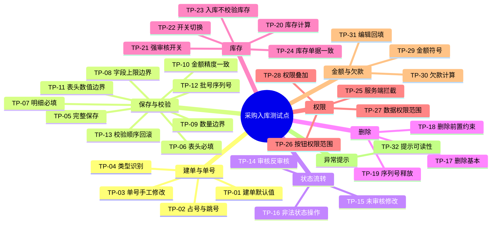

# 测试点：采购入库

> 阶段：测试点提取（阶段二） ｜ 版本：v1.0（定稿） ｜ 日期：2026-10-31

**材料**：原始需求（完整）；阶段一分析结果（有，`02-测试需求分析.md` v1.0 发布版）
**原文完整性**：完整
**范围**：需求规格说明 §二~§九 + 附录；不在范围：采购订单关联与分批入库、财务凭证与应付、多级审批、序列号/批号/多单位完整链路（各保留 1 条针对性验证）、商品档案维护、修正欠款的业务功能（仅验证其按钮受编号 1 控制）、性能、安全渗透、并发
**结论范围**：覆盖结论相对于本次提供的完整原文及阶段一分析结果。
**关键假设**：
- A1 配置基线为强审核开启、更新单价关闭、其余开关关闭；换配置后库存类结论会相反。
- A2 预期以需求规格说明为准；附录 8 条已知差异按"应然 vs 实现"判定，不因现状改写预期。
- A3 阶段一已确认的 7 条业务口径（`02` §4.3）作为测试预期；其中"入库不做库存不足校验""允许库存为负"两条与需求缺口相关。

## 1. 测试点清单

### 1.1 建单与单号

| 编号 | 短名 | 测试目标（含预期方向） | 测试关注点 | 依据 | 方法 |
|---|---|---|---|---|---|
| TP-01 | 建单默认值 | 验证新增页打开时单据编号、单据日期、结算账户与明细默认行是否自动带出且可修改；预期方向：默认值与建单规则一致 | 默认账户缺失、默认日期跨天、默认值被手工改坏 | REQ-03（原文明确） | 场景 |
| TP-02 | 占号与跳号 | 验证打开即占号、未保存关闭后的跳号是否只影响号码连续性而不造成重号；预期方向：允许跳号，不得出现重号 | 连续打开多个新增页、未保存关闭后的号段状态 | REQ-03、REQ-14（原文明确） | 场景 |
| TP-03 | 单号手工修改 | 验证系统生成的单号格式与手工改号后的唯一性；预期方向：默认号符合前缀加流水，手工改号只校验唯一性 | 改号后是否仍占用原号、格式约束是否只在前端 | REQ-14（原文明确） | 等价类 |
| TP-04 | 类型识别 | 验证采购入库单的类型标识是否为入库加采购，且与采购订单可区分；预期方向：类型正确，不与其他单据混淆 | 列表、筛选与统计中的类型呈现 | REQ-01（原文明确） | 场景 |

### 1.2 保存与校验

| 编号 | 短名 | 测试目标（含预期方向） | 测试关注点 | 依据 | 方法 |
|---|---|---|---|---|---|
| TP-05 | 完整保存 | 验证表头与明细完整时保存后状态为未审核、单据出现在列表；预期方向：保存成功且状态正确 | 表头与明细是否同批落库、列表是否即时可见 | REQ-04（原文明确） | 场景 |
| TP-06 | 表头必填 | 验证单据编号、日期、供应商、结算账户、本次付款缺失时是否整单不保存并给出对应提示；预期方向：逐项拦截，整单不落库 | 结算账户只对四类单据必选；付款为空与为 0 的区别 | REQ-09、REQ-11（原文明确） | 判定表 |
| TP-07 | 明细必填 | 验证仓库、商品条码、数量缺失或商品在档案中不存在时是否整单不保存；预期方向：整单拒绝 | 明细为空与商品条码不存在的区分；部分行合法时的处理 | REQ-10、REQ-11（原文明确） | 判定表 |
| TP-08 | 字段上限边界 | 验证编号、备注、明细备注、批号、序列号与附件在长度或数量上限及超限时的处理；预期方向：上限内放行，超限拒绝并提示 | 各字段上限不同；附件按单据累计计数 | REQ-09、REQ-18（原文明确）；Q-17（已确认：按条目计数） | 边界值 |
| TP-09 | 数量边界 | 验证数量为 0、为负、超过 6 位小数时是否按"必须大于 0"拦截；预期方向：非法值一律拒绝 | 当前实现已知缺失（D-02/D-03/D-04），需按需求判定 | REQ-10、REQ-18（原文明确）；附录 D-02/D-03/D-04 | 边界值 |
| TP-10 | 金额精度一致 | 验证单价与金额的精度边界，以及金额与数量乘单价不一致时是否被拦截；预期方向：不一致应被拒绝 | 金额由系统计算，手工改写后的校验 | REQ-10（原文明确）；附录 D-09 | 边界值 |
| TP-11 | 表头数值边界 | 验证本次付款的空值、0、格式错误、超过 4 位小数，以及优惠率 0 到 100 的边界；预期方向：付款为空、格式错误或超过 4 位小数时拒绝，填 0 放行；优惠率在 0–100 内放行，超出时提示 | 付款为空当前会触发未知异常（D-07） | REQ-09、REQ-18（原文明确）；附录 D-07 | 边界值 |
| TP-12 | 批号序列号 | 验证启用批号或序列号商品的条件必填、序列号个数与数量一致、同一单据内序列号不重复；预期方向：不合规拒绝 | 商品启用状态切换后校验是否跟随；序列号长度 | REQ-10（原文明确） | 判定表 |
| TP-13 | 校验顺序回滚 | 验证多个错误并存时的提示顺序，以及部分明细非法时是否整单不保存；预期方向：按规则顺序提示，不产生部分落库 | 校验是否短路、整单事务边界 | REQ-11、REQ-04（原文明确） | 判定表 |

### 1.3 状态流转

| 编号 | 短名 | 测试目标（含预期方向） | 测试关注点 | 依据 | 方法 |
|---|---|---|---|---|---|
| TP-14 | 审核反审核 | 验证未审核单据审核后变为已审核、已审核单据反审核后回到未审核并恢复改删能力；预期方向：状态往返正确 | 审核后修改与删除入口是否同步收敛 | REQ-05、REQ-06、REQ-02（原文明确） | 状态迁移 |
| TP-15 | 未审核修改 | 验证未审核单据修改后明细整体更新；预期方向：修改成功且明细与库存按新内容重算 | 明细增删改后是否残留旧行 | REQ-07（原文明确） | 状态迁移 |
| TP-16 | 非法状态操作 | 验证对已审核单据审核、修改、删除，或对未审核单据反审核时是否均被拒绝且状态不变；预期方向：拒绝并给出可读提示 | 绕过界面直接发起时的表现 | REQ-02（原文明确） | 状态迁移 |

### 1.4 删除

| 编号 | 短名 | 测试目标（含预期方向） | 测试关注点 | 依据 | 方法 |
|---|---|---|---|---|---|
| TP-17 | 删除基本 | 验证未审核单据删除后是否不在列表显示、库存是否按剩余单据重算；预期方向：删除成功且库存回落 | 逻辑删除后列表、详情与统计是否一致 | REQ-08（原文明确） | 场景 |
| TP-18 | 删除前置约束 | 验证被财务单据关联或序列号已出库的入库单删除是否被拒绝；预期方向：拒绝并提示具体原因 | "已出库"的判定口径；两类约束的提示是否可区分 | REQ-08（原文明确）；Q-13（已核实） | 判定表 |
| TP-19 | 序列号释放 | 验证删除入库单后其序列号是否释放、可被再次使用且无残留；预期方向：释放成功，可再次占用 | 释放后原单号下是否仍有记录 | REQ-08（原文明确） | 场景 |

### 1.5 库存

| 编号 | 短名 | 测试目标（含预期方向） | 测试关注点 | 依据 | 方法 |
|---|---|---|---|---|---|
| TP-20 | 库存计算 | 验证当前库存是否等于初始库存加盘点调整加入库合计减出库合计，并按基础数量计算；预期方向：结果与公式一致 | 多单位商品的换算；快照与动态计算是否同口径 | REQ-12（原文明确） | 场景 |
| TP-21 | 强审核开关 | 验证开关开启与关闭时，保存、审核、反审核对库存的影响是否符合口径；预期方向：开启时保存不计入、审核计入、反审核扣除，关闭时保存即计入 | 两种配置下结论相反，执行前必须核对配置 | REQ-16（原文明确） | 状态迁移 |
| TP-22 | 开关切换 | 验证切换开关后已有单据是否不受影响、下一次新建单据是否按新规则执行；预期方向：已有单据不因切换改变，新建单据按新开关计入 | 切换时点与配置核对；快照不因切换而重算 | REQ-16（原文明确）；02 §4.3 B-02 | 场景 |
| TP-23 | 入库不校验库存 | 验证采购入库保存与审核是否不会因库存不足被拒绝；预期方向：入库方向始终可完成 | 与出库类单据的校验差异；强审核开启时同样不校验 | REQ-13（原文明确）；02 §4.3 B-01 | 场景 |
| TP-24 | 库存单据一致 | 验证保存、修改、删除、审核、反审核之后库存与单据内容是否始终一致；预期方向：各动作后一致 | 库存为负时的一致性判定 | REQ-12（原文明确）；02 §4.3 B-03 | 场景 |

### 1.6 权限

| 编号 | 短名 | 测试目标（含预期方向） | 测试关注点 | 依据 | 方法 |
|---|---|---|---|---|---|
| TP-25 | 服务端拦截 | 验证无按钮权限、未授权菜单或绕过前端提交时，服务端是否独立拒绝；预期方向：服务端拦截，不只依赖界面隐藏 | D-01 与 D-06 同源；菜单直达与接口直达两条路径 | REQ-22、REQ-19（原文明确）；附录 D-01/D-06 | 错误推测 |
| TP-26 | 按钮权限范围 | 验证取消编号 1 后编辑类入口是否整组隐藏；预期方向：新增、批量删除、转采购退货、修正欠款、行内编辑、复制、删除同时隐藏，强制结单在出入库管理开启时一并隐藏 | 编号 1 是操作族总开关，共 8 个入口；需求 §3.3 写 5 个，属需求漏算（X-02） | REQ-20（原文明确）；02 §4.4 X-02 | 判定表 |
| TP-27 | 数据权限范围 | 验证全部数据、本部门数据、个人数据三档下列表与详情的可见范围；预期方向：按创建人归属过滤 | 人员调部门后历史单据的可见性 | REQ-21（原文明确） | 判定表 |
| TP-28 | 权限叠加 | 验证单据在数据上可见但用户没有按钮权限时，操作是否仍被拦截；预期方向：可见与可操作分离，操作被拒 | 数据权限与按钮权限交叉时的判定顺序 | REQ-20、REQ-21（原文明确） | 判定表 |

### 1.7 金额与欠款

| 编号 | 短名 | 测试目标（含预期方向） | 测试关注点 | 依据 | 方法 |
|---|---|---|---|---|---|
| TP-29 | 金额符号 | 验证明细金额为正、表头合计与本次付款为负的符号约定；预期方向：录入正数，存储与展示为负 | 金额合计不含税、价税合计含税，两套口径分别呈现 | REQ-15（原文明确）；02 §4.3 B-07 | 场景 |
| TP-30 | 欠款计算 | 验证本次付款小于、等于或大于含税合计时的欠款结果；预期方向：欠款 =（含税合计 − 优惠金额）+ 其他费用 − 订金 − 本次付款，允许为负 | 优惠金额 = 优惠率 ÷ 100 × 含税合计，按 2 位小数四舍五入；负欠款表示多付或预付；零收付款开关默认关闭，开启时本次付款记 0，欠款按同式得出 | REQ-15（原文明确）；02 §4.3 B-05、B-07 | 判定表 |
| TP-31 | 编辑回填 | 验证编辑已保存单据时金额回填与再次保存的一致性；预期方向：可正常保存，符号不翻转 | 负值回填与表单校验冲突（X-01），需实测确认 | REQ-15、REQ-07（原文明确）；TC-39（风险线索） | 错误推测 |

### 1.8 异常提示

| 编号 | 短名 | 测试目标（含预期方向） | 测试关注点 | 依据 | 方法 |
|---|---|---|---|---|---|
| TP-32 | 提示可读性 | 验证各拦截场景是否返回可读业务提示，而不出现未知异常、系统错误或堆栈；预期方向：提示可读且能定位到具体单据或商品 | 付款为空、备注超长的已知异常路径（D-07/D-08） | REQ-17（原文明确）；附录 D-07/D-08 | 错误推测 |

## 2. 思维导图

## 3. 覆盖检查

### 3.1 结论范围

覆盖结论相对于本次提供的完整原文及阶段一分析结果。

### 3.2 需求项覆盖

| 编号 | 需求项 | 来源 | 材料类型 | 对应测试点 | 状态 | 说明 |
|---|---|---|---|---|---|---|
| REQ-01 | 采购入库的单据类型定义 | 原文 4.1 | 原文明确 | TP-04 | 已覆盖 | 与采购订单的类型区分 |
| REQ-02 | 状态定义与允许的迁移 | 原文 4.2、4.3 | 原文明确 | TP-14、TP-16 | 已覆盖 | 仅 0 与 1 两态 |
| REQ-03 | 建单默认值与单号占用 | 原文 5.1 | 原文明确 | TP-01、TP-02 | 已覆盖 | 打开即占号、跳号正常 |
| REQ-04 | 保存与整单原子性 | 原文 5.2 | 原文明确 | TP-05、TP-13 | 已覆盖 | 任一校验失败整单不保存 |
| REQ-05 | 审核 | 原文 5.3 | 原文明确 | TP-14 | 已覆盖 | 仅未审核可审核 |
| REQ-06 | 反审核 | 原文 5.4 | 原文明确 | TP-14 | 已覆盖 | 回到未审核后恢复改删 |
| REQ-07 | 修改 | 原文 5.5 | 原文明确 | TP-15、TP-31 | 已覆盖 | 明细整体更新 |
| REQ-08 | 删除及前置约束 | 原文 5.6 | 原文明确 | TP-17、TP-18、TP-19 | 已覆盖 | 财务关联与序列号已出库 |
| REQ-09 | 表头字段规则 | 原文 6.1 | 原文明确 | TP-06、TP-11、TP-12 | 已覆盖 | 附件与优惠率同属表头 |
| REQ-10 | 明细字段规则 | 原文 6.2 | 原文明确 | TP-07、TP-09、TP-10、TP-12 | 已覆盖 | 条件必填与精度 |
| REQ-11 | 保存校验顺序 | 原文 6.3 | 原文明确 | TP-06、TP-07、TP-13 | 已覆盖 | 六步顺序与短路策略 |
| REQ-12 | 库存变化与计算 | 原文 6.4.1、6.4.2 | 原文明确 | TP-20、TP-24 | 已覆盖 | 基础数量与重算时机 |
| REQ-13 | 入库不参与库存不足校验 | 原文 6.4.3 | 原文明确 | TP-23 | 已覆盖 | 与 §7.1 的冲突已由 B-01 定 |
| REQ-14 | 单据编号规则 | 原文 6.5 | 原文明确 | TP-02、TP-03 | 已覆盖 | 格式、唯一性与跳号 |
| REQ-15 | 金额与符号 | 原文 6.6 | 原文明确 | TP-29、TP-30、TP-31 | 已覆盖 | 负数约定与欠款 |
| REQ-16 | 强审核开关 | 原文 7.1 | 原文明确 | TP-21、TP-22 | 已覆盖 | 两种配置与切换 |
| REQ-17 | 异常场景与提示 | 原文 八 | 原文明确 | TP-32 | 已覆盖 | 可读提示，不得未知异常 |
| REQ-18 | 阈值清单 | 原文 九 | 原文明确 | TP-08、TP-09、TP-11 | 已覆盖 | 长度、数量、精度、附件 |
| REQ-19 | 菜单权限 | 原文 3.2 | 原文明确 | TP-25 | 已覆盖 | 未授权菜单不可见且直达失败 |
| REQ-20 | 按钮权限 | 原文 3.3 | 原文明确 | TP-26、TP-28 | 已覆盖 | 编号 1 的按钮集合 |
| REQ-21 | 数据权限 | 原文 3.4 | 原文明确 | TP-27、TP-28 | 已覆盖 | 三档可见范围 |
| REQ-22 | 权限服务端生效 | 原文 3.5 | 原文明确 | TP-25 | 已覆盖 | 绕过界面也应被拒 |

### 3.3 维度覆盖

| 功能/流程 | 正常 | 规则 | 边界 | 异常 | 状态 | 权限 | 一致性 |
|---|---|---|---|---|---|---|---|
| 建单与单号 | TP-01 | TP-04 | — | — | — | — | TP-02、TP-03 |
| 保存与校验 | TP-05 | TP-06、TP-07、TP-12 | TP-08、TP-09、TP-10、TP-11 | TP-13 | — | — | — |
| 状态流转 | TP-14 | — | — | TP-16 | TP-14、TP-15 | — | — |
| 删除 | TP-17 | TP-18 | — | TP-18 | — | — | TP-19 |
| 库存 | TP-20 | TP-21、TP-23 | — | — | TP-21、TP-22 | — | TP-24 |
| 权限 | — | TP-25 | — | TP-25 | — | TP-26、TP-27、TP-28 | — |
| 金额与欠款 | TP-29 | TP-30 | — | TP-31 | — | — | TP-29 |
| 异常提示 | — | TP-32 | — | TP-32 | — | — | — |

### 3.4 阶段一交接

**TC 已吸收**（39 条全部吸收，未按 TC 机械展开，多条 TC 合并进同一测试点）：

- TC-01→TP-01；TC-02→TP-02；TC-03→TP-05；TC-04→TP-14；TC-05→TP-14；TC-06→TP-15；TC-07→TP-17；TC-08→TP-20；TC-09→TP-20；TC-10→TP-21；TC-11→TP-21；TC-12→TP-29；TC-13→TP-04
- TC-14→TP-06；TC-15→TP-07；TC-16→TP-08；TC-17→TP-09；TC-18→TP-10；TC-19→TP-11；TC-20→TP-11；TC-21→TP-08；TC-22→TP-12；TC-23→TP-12；TC-24→TP-13；TC-25→TP-13
- TC-26→TP-16；TC-27→TP-18；TC-28→TP-32；TC-29→TP-25；TC-30→TP-26；TC-31→TP-27；TC-32→TP-28；TC-33→TP-25；TC-34→TP-25；TC-35→TP-24；TC-36→TP-22；TC-37→TP-19；TC-38→TP-30；TC-39→TP-31

**TC 未吸收**：无。

**Q 已解决**：Q-01~Q-06、Q-08~Q-16 已关闭（Q-08~Q-11、Q-13~Q-16 由实现现状回答；Q-01~Q-06、Q-12 由 B-01~B-07 确认口径，见 `02` §4.1、§4.3）；Q-17 按口径①确认（按条目计数，重复文件各算一份）。

**Q 沿用**：Q-07（部分；编号 1 整组生效已确认，编号 4/5/6 在其他页面的使用未核对，不影响本页测试点）。

**Q 不影响测试点**：无。

**本次新增**：无未决项。

### 3.5 材料差异与缺口

- **阶段一漏项**：原文 3.1 的角色定义未单独生成测试点，作为权限类场景的前置条件使用；原文 4.1 的单据类型由 TP-04 补齐。
- **阶段一有、完整原文确无依据**：无。阶段一的实现现状与清单外发现（X-01~X-04）来自代码核对，不作为需求项。
- **原文与阶段一冲突**：§6.4.3 与 §7.1 关于"审核时库存不足校验"的表述相反；阶段一 Q-01 已记录，本阶段按 B-01 确认的"入库不校验"处理。
- **原文缺口**：
  - 负库存：原文未定义，B-03 确认允许，作为需求缺口记录，不生成缺陷类测试点。
  - 附件重复上传：原文只写"最多 4 份"，未定义去重；Q-17 已确认按条目计数。

## 4. 待确认项

无影响测试点的未决项。Q-17 已按口径①确认；Q-07 的其余部分不影响本页测试点，见 3.4。
